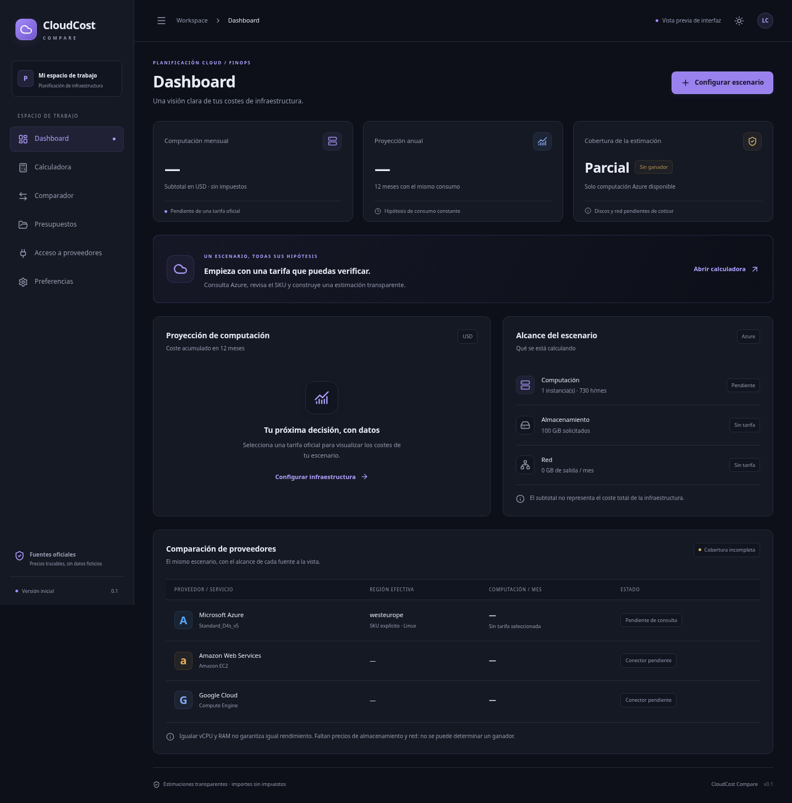

# CloudCost Compare

Primera versión de una **aplicación de escritorio Windows/Linux** con Tauri 2, React, TypeScript y Rust. Interfaz en español, temas claro/oscuro y SQLite local. **v0.1 es una base funcional parcial, no un comparador multicloud completo.**



## Desarrollo

Requisitos: Node.js 22.12+, Rust estable, dependencias Tauri. En Windows: Microsoft C++ Build Tools (carga de trabajo de desarrollo de escritorio C++), Windows SDK y WebView2. En Linux: WebKitGTK 4.1 y paquetes indicados en el workflow.

```sh
npm ci
npm test
npm run build
npm run desktop
```

`npm run dev` abre solo el frontend en `http://127.0.0.1:1420`; consultar tarifas y SQLite requiere Tauri. No es un servidor de precios ni una aplicación web convencional.

## Uso

1. Abre Calculadora y especifica un SKU Azure y una región admitida (por ejemplo `Standard_D4s_v5`, `westeurope`). Verifica sus vCPU/RAM en la documentación de Azure.
2. Configura instancias, horas y necesidades de almacenamiento/red.
3. Consulta tarifas oficiales. Selecciona expresamente un producto de la lista para calcular su computación Linux de pago por uso.
4. Consulta proyecciones, guarda snapshots y exporta CSV/JSON. La impresión del sistema permite guardar PDF donde esté disponible; no hay generador PDF nativo.
5. Presupuestos permite importar JSON, abrir escenarios y duplicarlos al guardar de nuevo.

No hay datos ficticios en producción. Sin una tarifa real no se muestra un importe. Los únicos valores sintéticos están en pruebas. La tarifa no acredita equivalencia de rendimiento. Almacenamiento y tráfico **no se incluyen** en el subtotal, ni soporte, licencias, reservas, descuentos, impuestos u otros servicios. No se declara ganador mientras falte cobertura multicloud.

## Instaladores

```sh
# Windows
npm run tauri -- build --bundles nsis
# Linux
npm run tauri -- build --bundles deb,appimage
```

GitHub Actions ejecuta pruebas y genera artefactos de Windows y Linux por cada push. Descarga los paquetes desde la ejecución de Actions una vez que termine correctamente. No hay firma de código configurada. No se distribuye un instalador hasta comprobar que su compilación pasó.

## Estado y validación

La revisión de interfaz y estabilidad incorpora pruebas unitarias TypeScript, pruebas de navegador Chromium y pruebas del núcleo Rust sin GUI. Consulta [la revisión técnica](docs/REVIEW.md) para sus resultados. En este entorno se instaló Rust únicamente en el directorio de trabajo, sin privilegios; faltan las bibliotecas gráficas de Linux, por lo que los instaladores se compilan en GitHub Actions.

La ejecución inicial de Actions [40657232835](https://github.com/nrcb28/CalculatorCLOUD/actions/runs/40657232835) terminó correctamente con pruebas y paquetes NSIS, .deb y AppImage. Eso acredita la compilación de la versión inicial; cada revisión posterior debe pasar su propia ejecución.

El proxy del entorno bloquea `prices.azure.com` (HTTP 403), por lo que **el conector Azure no ha sido probado contra el servicio real**. AWS y GCP no tienen todavía conectores de estimación. El panel de acceso comprueba los endpoints públicos de Azure y AWS y permite una prueba de GCP mediante API key efímera: no se guarda en disco. Las pruebas de navegador sustituyen IPC por dobles de prueba en determinados casos; no acreditan conexión real con los proveedores.

Para ejecutar todas las comprobaciones:

```sh
npm test
npx playwright install chromium
npm run test:e2e
npm run format:check
npm audit
cargo test --locked --manifest-path src-tauri/Cargo.toml --no-default-features --lib
```

Para usar el Chromium del sistema en Linux: `PLAYWRIGHT_CHROMIUM_EXECUTABLE=/usr/bin/chromium npm run test:e2e`.

USD es la única moneda soportada. El cálculo usa `decimal.js`; anual = mensual × 12, diario medio = mensual / 30. Horas permitidas: 0–744. Los snapshots guardan fuente, fecha y tarifa. La caché expirada se identifica y puede recuperarse si falla la red. El tema y la caducidad persisten localmente. Las fechas futuras de caché se consideran no fiables. Los errores de actualización se muestran cuando se recuperan datos guardados.

## Fuentes oficiales y referencias para continuar

- Tauri 2: https://v2.tauri.app/start/prerequisites/
- Azure Retail Prices: https://learn.microsoft.com/rest/api/cost-management/retail-prices/azure-retail-prices
- AWS Bulk: https://docs.aws.amazon.com/awsaccountbilling/latest/aboutv2/using-the-aws-price-list-bulk-api.html
- AWS Query: https://docs.aws.amazon.com/awsaccountbilling/latest/aboutv2/using-price-list-query-api.html
- GCP catálogo: https://cloud.google.com/billing/v1/how-tos/catalog-api
- GCP Pricing: https://cloud.google.com/billing/docs/how-to/get-pricing-information-api
- Calculadoras de referencia: https://azure.microsoft.com/es-es/pricing/calculator/ · https://calculator.aws/ · https://cloud.google.com/products/calculator

No se hace scraping. Estas referencias requieren revisión adicional en una red con acceso: no se afirma haber verificado en línea toda su documentación en este entorno.

Consulta [plan](docs/PLAN.md) y [arquitectura](docs/ARCHITECTURE.md) para el alcance y los pendientes.
